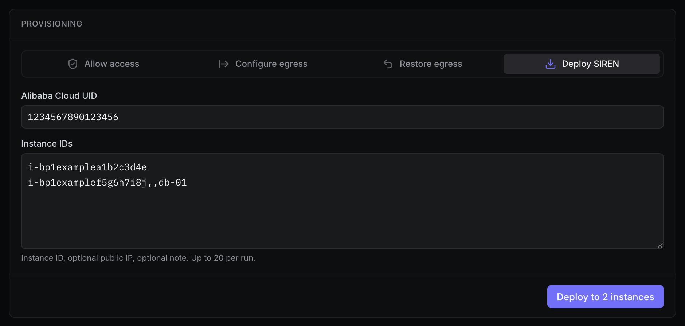

import { Callout } from "fumadocs-ui/components/callout";
import { Steps, Step } from "fumadocs-ui/components/steps";

**Deploy SIREN** 通过 SOAR 剧本和阿里云云助手向 ECS 安装 SIREN 客户端、放行其回连 IP，并等待客户端实际连上服务端。入口是 Clients 页 **Provisioning** 面板的 **Deploy SIREN** 标签。

## 前置条件

- 目标是阿里云 ECS 上的 Linux 或 Windows 主机，云助手状态正常；已知其所属账号的 Alibaba Cloud UID。
- 服务端已配置 SOAR 访问凭证与 `egress.rules`，见 [前置条件与凭证](/server/prerequisites)。
- `egress.rules` 中 `siren_server_callback` 规则的 `destCidrIp` 是服务端公网 IP，且只含这一个 IPv4 地址（`/32`），目标主机客户端按它回连。不满足时部署直接失败：`SIREN callback must configure exactly one server IP (destCidrIp ending in /32)`。

## 操作步骤

<Steps>
<Step>
在 Clients 页展开 **Provisioning** 面板，选择 **Deploy SIREN** 标签。已有客户端在线时面板默认折叠，展开或折叠的选择会被记住。
</Step>
<Step>
填写 **Alibaba Cloud UID**（纯数字），在 **Instance IDs** 中每行填一个目标。
</Step>
<Step>
点击 **Deploy to N instances**。面板显示完成数和结果计数；每个目标的状态、原因和日志在下方 [Recent activity](/clients#recent-activity) 本次部署的记录中。
</Step>
</Steps>



部署按钮下方的 **Or install manually** 给出在主机上手动安装并连接的命令，适用于不能一键部署的主机，见 [手动安装客户端](/onboard/manual)。

### 目标格式

每行格式为 `instanceId[,publicIp[,note]]`：

```text title="Instance IDs"
i-demo0001
i-demo0002,203.0.113.10
i-demo0003,,web-1
i-demo0004,203.0.113.11,db-1
```

- `instanceId` 必填，形如 `i-...`；公网 IP 可选，见 [手动指定出口 IP](#注意事项)；备注可选，最长 256 个字符。
- 每批 1–20 个目标，单个失败不影响其他目标。同一实例的公网 IP 或备注不一致时报错。

## 部署流程

未手动指定出口 IP 时，SIREN 在目标主机安装客户端并探测一次出站连接，等云防火墙日志关联出该连接的公网出口 IP（日志迟迟不到会超时失败），为该 IP 的 `/32` 放行服务端回连端口，再等待客户端上线（最长 30 秒）。

客户端实际连上才算成功，面板显示 `connected`。安装成功但未按时连上则以超时失败结束，并提示可能需要配置出站。

从 Project 视图发起的部署，客户端自动归入当前 Project；目标已归属另一个 Project 时部署被拒绝，见 [部署时自动归属](/projects#部署时自动归属)。

<Callout title="需要手工确认客户端" type="warn">
  SIREN 无法确认新上线的客户端就是该目标时（如多个目标共享出口 IP），不按 IP 猜测，也不写入 Project 或备注。该目标在 Recent activity 中显示为 **Manual**，需在 Clients 中核对主机后手动设置；它已经连上，面板不为它提供重试，**Copy N failed IDs** 也不包含它，以免重复部署。
</Callout>

## 结果与记录

- **重试**：存在失败目标时，**Retry N failed** 只重新提交失败项，沿用原 UID 和 Project；**Edit targets** 修改目标后重新开始。
- **安装无结果**：云助手没有返回安装命令的执行结果时，日志按目标的云助手状态给出可能原因：云助手在线时多为无法下载客户端，需配置出站；从未上报时多为未安装云助手；已离线时给出最后心跳时间，可能是出站、主机防火墙或 EDR 隔离所致。
- **出站问题**：失败明确指向出站时，面板出现 **Configure egress for N target(s)**，带入这些实例切到 [配置出站](/onboard/egress)。
- **Recent activity**：**View logs** 跳到本次部署在 Clients 页 [Recent activity](/clients#recent-activity) 中的记录，展开后逐个目标查看结果、原因和日志，并可复制失败目标的实例 ID 重新部署。记录在服务端重启后清空。刷新页面或关闭浏览器不会取消云端操作。

<Callout title="结果未知时先看 Recent activity" type="warn">
  目标显示 **Needs verification**（如部署事件流中断）时，服务端可能仍在执行。不要直接重试，先在 Recent activity 核对最终结果再决定。
</Callout>

## 注意事项

- **出站默认拒绝**：目标 ECS 出方向默认拒绝时无法回连，先 [配置出站](/onboard/egress)。
- **动态出口**：单次探测只确认该次连接的出口 IP，后续连接换了公网地址仍可能连不上；SIREN 不会放行整个出口池。每次重试都重新探测。
- **手动指定出口 IP**：SOAR 无法返回出口 IP，或系统不支持自动抓包（如需要第三方抓包驱动的 Windows）时，在目标行第二列填入核对过的公网出口 IP（可在主机上用 `curl ifconfig.co/ip` 获取），SIREN 跳过自动发现直接放行。

<Callout title="自动化部署" type="info">
  MCP `deploy` 工具走同一套部署流程，见 [MCP 集成](/reference/mcp)。
</Callout>
