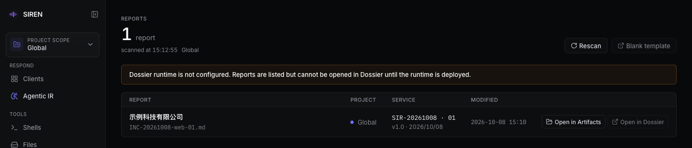

import { Callout } from "fumadocs-ui/components/callout";
import { Accordion, Accordions } from "fumadocs-ui/components/accordion";
import { Step, Steps } from "fumadocs-ui/components/steps";

SIREN 的应急响应报告是保存在 [Artifacts](/artifacts) 中的 Dossier Markdown 文件（`.md`）。WebUI 的 **Reports** 页列出这些报告，Dossier 编辑器负责编辑、校样和导出 PDF / HTML。写法见 [报告语法](/reports/syntax)，大小和超时上限见 [限制](/reference/limits#reports-与-dossier)。

## 前置条件

- 已 [部署 Dossier](/server/dossier)。未部署时 Reports 页仍会列出报告，但无法在 Dossier 中打开。
- 使用桌面版 Chrome 或 Edge。移动端只适合预览。

## 什么算一份报告

`.md` 文件的 `---` frontmatter 从第一行开始（允许 UTF-8 BOM），并且四个字段齐全：

```md
---
date: 20261008
sir-seq: 01
version: 1.0
client: 示例客户
---
```

| 字段 | 含义 |
| --- | --- |
| `date` | 报告日期，8 位数字 |
| `sir-seq` | 服务序号，通常两位，首次交付写 `01` |
| `version` | 报告版本，如 `1.0` |
| `client` | 客户名称，Reports 页以它作为报告标题 |

Recon 生成的 `.md` 和普通笔记没有这组字段，不会列出。`.markdown` 文件只能在 Artifacts 中预览，不能在 Dossier 中编辑。

## 创建报告

WebUI 不能新建文件。报告通过以下途径进入 Artifacts：

- **由 AIR 生成**：Agent 写出报告后，该轮末尾出现 **Report** 卡，点 **Edit in Dossier** 继续编辑，见 [Report 卡](/air/gui#report-卡)。
- **上传已有报告**：在 [Artifacts](/artifacts#文件操作) 中把 `.md` 上传到目标目录。
- **从空白模板起草**：在 Reports 页点 **Blank template**，编辑后用 **导出** → **MD** 下载源文件，再上传到 Artifacts。模板本身不能保存。

<Callout title="不要在 Blank template 中粘贴图片" type="warn">
  模板虽然只读，但粘贴的图片会立即写入 Dossier 目录下的 `report.assets/pasted/`。这个目录不需要登录即可访问，也不属于任何报告，见 [`/dossier/` 不鉴权](/server/security#dossier-不鉴权)。先把报告上传到 Artifacts，从 Artifacts 打开后再粘贴截图。
</Callout>

## Reports 页



Global 视图扫描服务端工作目录和所有 Project 目录；Project 视图只扫描该 Project 的目录。每行可以 **Open in Artifacts** 或 **Open in Dossier**（在新标签页编辑）。

每个范围只在首次进入时自动扫描一次，之后新增或修改的报告要点 **Rescan** 才会出现。扫描时跳过：

- 以 `.` 开头的目录和文件、符号链接、`node_modules`、`*.assets` 附件目录，以及 `webui.dossierDir`。
- 超过 5 层子目录的位置。每个根目录最多检查 20000 个条目，达到上限时页面顶部显示 **partial scan**，更深的报告可能缺失。
- 超过 10 MiB 的 `.md` 文件。

## 在 Dossier 中编辑

<Steps>
<Step>

### 打开报告

从 Reports 页的 **Open in Dossier**、Artifacts 中选中 `.md` 后的 **Dossier** 按钮，或 AIR Report 卡的 **Edit in Dossier** 打开。Dossier 在新标签页中加载文件，保存时写回原位置。报告链接可以直接发给其他操作员，未登录时先进入登录页，登录后回到该报告。

</Step>
<Step>

### 编辑源文件

左侧是源码面板，右侧实时渲染 A4 预览。源码面板底部的 **待填** 统计未替换的模板占位（如 `[ 客户名称 ]`）和 [截图占位](/reports/syntax#截图占位)，**目录** 打开报告大纲，有解析错误时出现 **跳到错误**。工具栏的 **?** 按钮打开帮助，其中有语法指南、快捷键和结构块模板。

</Step>
<Step>

### 校样

打开工具栏 **校样**，预览按导出 PDF 的真实页高裁切并标出溢出的页面。修完后关闭校样再继续编辑。

</Step>
<Step>

### 保存

点 **保存** 或按 `⌘S` / `Ctrl+S`，源文件写回服务端。文件名后的 ` *` 表示还有未保存的修改。报告在别处被改写时的处理见 [报告被别处修改](#报告被别处修改)。

</Step>
</Steps>

### 报告语言

工具栏的 **中 | EN** 切换报告语言。语言是当前浏览器的偏好，不写入 Markdown 源文件：

- 切换后，封面、法律声明、目录、服务概述、版权页和报告中的固定标签改为对应语言。
- 文档仍是未改动的默认模板时，换成另一种语言的模板；其他文档保留正文，只改上述内容。
- **Blank template** 按当前语言打开中文或英文模板。
- 编辑器界面始终是中文。导出的 HTML 保持导出时的语言。

### 报告被别处修改

AIR 或其他操作员可能在你编辑时改写同一份报告。标签页在前台时，Dossier 每 30 秒检查一次服务端文件：

- **没有未保存的修改**：自动载入最新版本。
- **有未保存的修改**：修改保留，源码面板底部提示报告已更新。保存时打开 **保存冲突：报告已被更新** 对话框，显示服务器上的改动和双方改动的行数。

对话框中的选项：

| 选项 | 结果 |
| --- | --- |
| **合并并保存** | 合并双方的修改后保存。只在两边没有改到同一行时提供 |
| **用服务器版本** | 放弃你的修改，载入服务器上的版本 |
| **用我的版本覆盖** | 用你的版本覆盖服务器上的修改 |
| **暂不保存** | 不保存，修改留在浏览器草稿中 |

草稿基于更早的服务端版本、无法判断双方各改了什么时，不提供合并，对话框显示从你的版本到服务器版本的差异。

### 版本历史

SIREN 为每份报告保留最近 100 个版本。每次保存记一个版本；Dossier 打开或定时检查报告时发现磁盘上的改动（如 AIR 改写），也记一个版本。报告改名或移动后从头记录。

工具栏的版本按钮显示 frontmatter 中的版本号，如 `v1.0`。点击后选 **版本历史**，列出各版本的时间和来源（**编辑器保存** 或 **磁盘上的改动（如 AIR）**）。选中一个版本，可以查看 **这一版改了什么**（与上一版的差异）或 **与当前内容的差异**。**恢复到此版本** 把它载入编辑器，作为未保存的修改，保存后才生效。编辑器中还有未保存的修改时，恢复前先请求确认。

同一菜单中的 **升版本** 把 `version` 加 0.1，菜单中显示新版本号；同时在修订记录（[`rev`](/reports/syntax#rev)）中添加一行，描述留作待填 `[ 本次修订内容 ]`。可以撤销。

### 保存失败

只有 SIREN 明确返回成功才算保存完成。失败原因显示在源码面板底部，修改仍保留在编辑器和浏览器草稿中：

- **登录过期**：回到 WebUI 重新登录，再在 Dossier 中保存。
- **15 秒内无响应**：提示保存超时，稍后重试。
- **反向代理返回登录页或其他非预期响应**：按失败处理。只代理 `/dossier/` 时常见，见 [部署 Dossier](/server/dossier#注意事项)。
- **Blank template**：模板只读，保存返回 HTTP 403。
- **报告已被更新**：打开报告后，AIR 或其他操作员改写了同一份文件。服务端文件不变，Dossier 打开保存冲突对话框，见 [报告被别处修改](#报告被别处修改)。
- **报告加载失败**：文件读取失败或没有任何 `##` 章节时，Dossier 显示内置模板作为只读预览并阻止保存，避免覆盖原文件。修正文件后重新打开。

## 粘贴图片

在源码面板中粘贴或拖入图片，Dossier 会把它上传到报告同目录的 `<报告名>.assets/pasted/`，并在光标处插入引用：

```md
{caption=""}
```

在 `caption=""` 中填写图注，不需要时删掉这个属性。

光标在 [截图占位](/reports/syntax#截图占位) 所在行时粘贴，图片路径填入该占位，图注保留。

- 只接受 PNG、JPEG、WebP 和 GIF，单张不超过 100 MiB。
- 在 SIREN 中，报告引用的本地图片必须位于 `<报告名>.assets/` 目录内，否则无法显示。手工放入的截图也放到这里。

## 浏览器草稿

编辑内容自动保存到浏览器 IndexedDB，防止崩溃或误关时丢失，不替代 **保存**：

- 重新打开同一份报告时，草稿与服务端文件不同就自动加载，工具栏显示 **草稿**；相同则丢弃。保存成功后草稿清除。
- 草稿记住它基于的服务端版本。之后服务端文件被改写时，保存草稿会打开保存冲突对话框，见 [报告被别处修改](#报告被别处修改)。点工具栏 **草稿** 旁的 **放弃** 回到服务端版本。
- 每个浏览器只保留一份草稿，编辑另一份报告会覆盖它，切换报告前先保存。

## 交付检查

从 SIREN 打开的报告可以在交付前检查。SIREN 用服务端 dossier Skill 的检查脚本检查编辑器中的当前内容，包括未保存的修改；检查规则由 Skill 维护。

- 点 **导出** → **交付检查**，列出 FAIL 和 WARN。FAIL 要在交付前清零，WARN 逐条确认。点带行号的条目跳到对应行。
- 源码面板底部显示报告上次载入或保存时的检查结果，如 `检查通过` 或 `检查 2 FAIL · 1 WARN`，点击重新检查并查看。
- 服务端没有安装 dossier Skill 时，检查报错 "SIREN 上没有安装 dossier Skill，无法运行交付检查"，见 [部署 Dossier](/server/dossier#交付检查)。**Blank template** 和离线使用时没有交付检查。

## 导出

| 格式 | 结果 |
| --- | --- |
| **PDF** | 打开浏览器打印对话框，选择 “保存为 PDF” |
| **HTML** | 下载单文件 HTML 留档，内嵌图片和字体，不含源码中的 HTML 注释 |
| **MD** | 下载当前源文件，保留 HTML 注释 |

源文件有解析错误、图片未上传完成或上传失败、图片或字体加载失败、引用了本报告附件以外的图片时，导出中止并提示原因。导出 HTML 时如果服务端上的 Dossier 已更新，刷新页面后重新导出。

导出 PDF 前，如果还有未填写的模板占位或截图占位、[交付检查](#交付检查) 还有 FAIL，或有 PDF 中打不开的链接，会先请求确认。PDF 中只有 `http(s)` 和 `mailto` 链接能打开，指向附件的相对路径链接应改写为纯文本文件名。PDF 目录的每一行都链接到对应章节，点击即可跳转。

导出交付用的 PDF 前先 **保存**，并在 **校样** 中检查溢出、图片尺寸和分页。

## 离线使用

Dossier 可以脱离 SIREN 在本地使用，见 [本地离线使用](/server/dossier#本地离线使用)。首次保存会要求选择 `.md` 的写入位置；首次粘贴图片会要求选择包含 `index.html` 的 Dossier 目录，图片写入其中的 `assets/pasted/`。

## 常见问题

<Accordions>
<Accordion title="报告没有出现在 Reports 页">
对照 [什么算一份报告](#什么算一份报告) 和 [扫描规则](#reports-页) 检查文件，然后点 **Rescan**。Global 视图中，Project 目录里的报告列在对应 Project 下。
</Accordion>
<Accordion title="Open in Dossier 和 Blank template 是灰的">
Dossier 未部署或路径配置错误时，页面顶部会显示提示，两个按钮都不可点；只缺默认模板时只有 **Blank template** 不可点。排查见 [部署 Dossier](/server/dossier#验证)。
</Accordion>
<Accordion title="Dossier 打开后显示的是模板，不是我的报告">
报告加载失败，或文件里没有任何 `##` 章节，见 [保存失败](#保存失败)。检查文件内容后从 Artifacts 重新打开。
</Accordion>
<Accordion title="报告中的图片显示不出来">
SIREN 中只能显示 `<报告名>.assets/` 目录内的 PNG、JPEG、WebP、GIF 和 SVG 图片。把图片移到该目录并修改引用路径，或在编辑器中重新粘贴。
</Accordion>
</Accordions>
