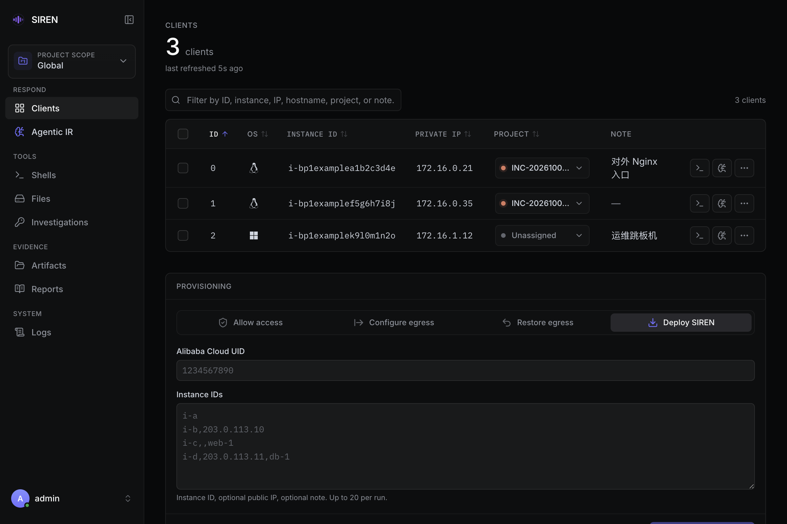

Web 控制台是使用 SIREN 的主要方式，浏览器直接访问 `https://<SIREN Server 域名>`。安装与端口见 [安装服务端](/server)，账号与鉴权见 [账号与安全边界](/server/security)。

## 导航

左侧导航按应急流程分为四组：

| 分组 | 页面 | 用途 |
| --- | --- | --- |
| **Respond** | [Clients](/clients)、[Agentic IR](/air)、[Case Board](/air/case-board) | 在线客户端列表与 **Provisioning**（部署、放行、出站恢复）；AI 辅助排查；排查进度 |
| **Tools** | [Shells](/shells)、[Files](/files)、[Investigations](#investigations)、[Cloud Access](/consoles) | 交互式终端；客户端文件浏览和上传下载；Recon / 进程分析 / AccessKey 调查；客户云控制台的独立浏览器和 Project AccessKey |
| **Evidence** | [Artifacts](/artifacts)、[Reports](/reports) | 服务端证据目录；当前范围内的 Dossier 应急报告 |
| **System** | [Projects](/projects)、[Usage](/usage)、[Logs](/logs) | 新建和管理 Project；AI 用量与费用统计；服务端运行日志与 MCP 命令审计 |

导航之外还有两个入口：

- **范围菜单**：侧栏顶部的 **Project scope**，在 Global 和各 Project 视图之间切换，见 [范围菜单](#范围菜单)。
- **账号菜单**：侧栏左下角，提供 [Settings](#settings)、本文档（**Docs**）、问题反馈（**Feedback**）和退出登录。

每个页面、工具标签、AIR 会话和选中文件都有自己的 URL，可以刷新或分享。

本文档统一使用英文界面的名称，中文界面的对应名称见 [界面语言](#界面语言)。

## 范围菜单

点击侧栏顶部的 **Project scope** 打开范围菜单。在桌面浏览器中，也可以在任意页面按 `⌘K`（Windows 和 Linux 上为 `Ctrl+K`）打开。焦点在输入框或终端中时，这个快捷键不生效。

菜单顶部是 **Search projects** 搜索框，打开菜单后可以直接输入：

- 搜索匹配 Project 名称、目录名、负责人和客户 UID，不区分大小写。
- 搜索范围包括所有状态的 Project。
- 按 Enter 切换到第一个匹配项。

不输入搜索词时，**Global** 排在最前，Project 分组如下：

| 分组 | 内容 |
| --- | --- |
| **Recent** | 当前 Project 排第一，其后是这个浏览器最近切换过的 Project，合计最多 5 个 |
| **In progress** | 其余状态为 **Responding** 和 **Wrapping up** 的 Project |
| **On hold**、**Done** | 默认折叠，显示 Project 数量；点击展开 |

每个 Project 只出现在一个分组中。**On hold** 和 **Done** 的 Project 出现在 **Recent** 或搜索结果中时，行尾标出状态。

菜单底部的 **Manage projects** 打开 [Projects](/projects) 页面。

## Investigations

需要等待结果的调查工具，分为 **AccessKey**、**Recon** 和 **Process analysis** 三个标签，切换标签不丢失已有结果。见 [AccessKey 调查](/ak)、[自动化信息收集](/recon) 和 [进程分析](/process)。

## Settings

从左下角的账号菜单打开，分四个标签：

- **Personal**：只保存在当前浏览器，不跟随账号同步。
  - Language：界面语言，见 [界面语言](#界面语言)。
  - 启动时的 Project 范围：沿用上次的范围（刷新时各标签页保持自己的范围），或每次从 Global 开始。
  - Agentic IR 默认 Provider：沿用上次（还没有选过时跟随服务端的 `air.provider`），或固定 Codex / Claude / Pi，单次会话仍可临时切换。
  - Agentic IR 默认界面：沿用上次，或固定 Chat / Terminal。
  - AIR 系统通知：默认开启，没在看的会话完成或等待时弹出浏览器通知，见 [系统通知](/air/sessions#系统通知)。
  - Clients 列表刷新频率。
- **AIR**：全部用户共用的 AIR 默认值，任何登录用户都可以修改，点击 **Save** 后对之后新启动的 GUI 和 Terminal 会话生效，已在运行的会话不受影响。
  - 每个 Provider 的默认模型和 effort。留空时沿用该 Provider 自己的配置，输入框和下拉框中灰色显示当前生效的值。新建会话时可以在模型菜单中为单个会话另选模型，见 [选择模型和界面](/air/sessions#选择模型和界面)。
  - **Delegate workers**：[多 Agent 分工](/air/sessions#多-agent-分工) 中 **Entry**、**Host**、**Cloud** worker 各用哪个 Provider、模型和 effort。留空时用内置默认值：三个角色都用 Pi 的 DeepSeek V4.1 Flash，effort 为 max。换了 Provider 后，模型和 effort 按新 Provider 重新填写。
  - **Instructions**：追加到每个 AIR 会话系统提示词的文字，排在 Provider 自身配置的指令之后。
  - **Quick prompts**：新建会话表单和 Chat 输入框中的常用请求，每项有名称和文本，点击 **Add quick prompt** 添加。从没保存过时显示内置的五项：排查告警、同步给客户、写阶段简报、写正式报告、审校报告。保存后立即生效，其他已打开的页面刷新后更新；删除全部并保存后，不再显示常用请求。
  - 保存前别人已经改过时，页面提示 **Reload**；重新加载会用对方的版本替换你未保存的修改。
- **MCP & Skills**：只读列出 AIR 会话可用的 MCP 服务器和服务端 `~/.agents/skills` 下的 Skills。MCP 服务器标出来源 Provider，SIREN 自己的 MCP 排在最前；页面不显示 MCP 的请求头、令牌和命令参数。
- **Server**：只读的版本号、鉴权状态与当前用户、Dossier 目录，以及每个 AIR Provider 实际可用的界面；Provider 不可用时显示原因。

## 界面语言

WebUI 提供简体中文和英文两种界面语言。首次打开时界面跟随浏览器语言：浏览器语言是中文时显示简体中文，其他情况显示英文。

在 [Settings](#settings) 的 **Personal** 标签第一行 **Language**（语言）中选择 **Follow browser**（跟随浏览器）、**English** 或 **简体中文**。

- 换成另一种语言时页面刷新一次。正在运行的 AIR 会话保留在服务端，刷新后自动重新接入。
- 每个浏览器各自保存语言选择。
- 只有界面文案和 AIR 会话的结束原因会翻译，结束原因见 [停止与结束](/air/sessions#停止与结束)。服务端返回的其他错误信息、日志、Agent 输出、Case Board 内容和导出文件保持原文。
- 日期、时间和数字按界面语言格式显示，例如 Usage 页的调用数在中文界面中显示为 `1.2万`。

中文界面的导航和入口名称对应如下。Agentic IR 以及 AIR、Recon、Dossier、SOAR、MCP 等专有名词在中文界面中保留英文。

| 位置 | 英文界面 → 中文界面 |
| --- | --- |
| **Respond**（响应） | Clients → 客户端、Case Board → 案件看板 |
| **Tools**（工具） | Shells → 命令行、Files → 文件、Investigations → 调查、Cloud Access → 云访问 |
| **Evidence**（证据） | Artifacts → 产物、Reports → 报告 |
| **System**（系统） | Projects → 项目、Usage → 用量、Logs → 日志 |
| 范围菜单 | Project scope → 项目范围、Search projects → 搜索项目、Global → 全局、Recent → 最近、In progress → 进行中、No matching projects → 没有匹配的项目、Manage projects → 管理项目 |
| 账号菜单 | Settings → 设置、Docs → 文档、Feedback → 反馈 |
| Settings 标签 | Personal → 个人、MCP & Skills → MCP 与技能、Server → 服务器 |
